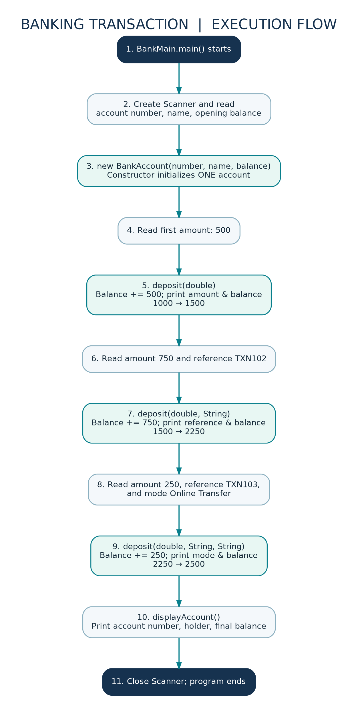
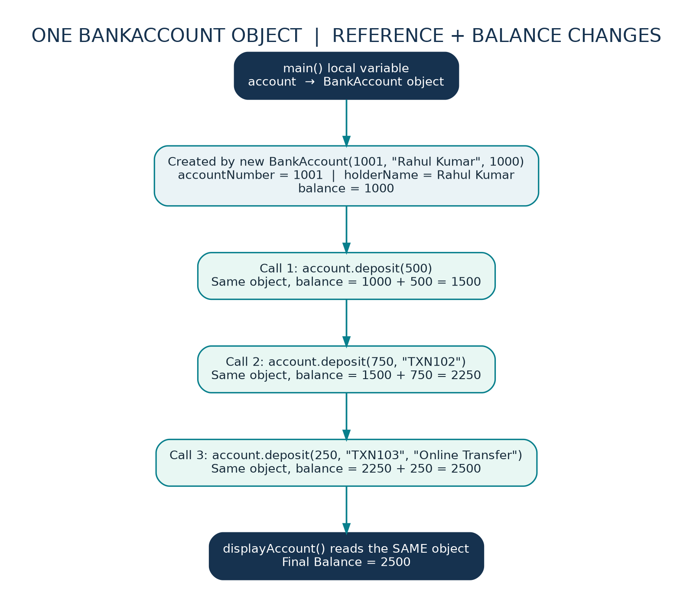

# Java Assignment — Banking Transaction System

**Concept:** Method Overloading (Compile-Time Polymorphism)  
**Assignment:** Part II, Problem 3  
**Package:** `BankingTransaction`

## Objective

Create one `BankAccount` object with an account number, account holder name and opening balance. Use three overloaded `deposit()` methods to add money in three ways, display the transaction information, and show the final balance.

## Project structure

```text
Assignment_6/
└── BankingTransaction/
    ├── BankAccount.java
    ├── BankMain.java
    ├── README.md
    └── diagrams/
        ├── execution-flow.png
        └── object-memory.png
```

## Classes

| File               | Responsibility                                                                                                                                          |
| ------------------ | ------------------------------------------------------------------------------------------------------------------------------------------------------- |
| `BankAccount.java` | Declares account fields, initializes them through the constructor, contains three overloaded `deposit()` methods, and prints the final account details. |
| `BankMain.java`    | Reads input with `Scanner`, creates one `BankAccount` object, calls each `deposit()` overload once, then calls `displayAccount()`.                      |

## Class diagram


## Execution flow diagram



## Object/reference and balance diagram



## How method overloading works

All three methods are named `deposit`, but their parameter lists are different:

```java
void deposit(double amount)
void deposit(double amount, String transactionReference)
void deposit(double amount, String transactionReference, String depositMode)
```

- `account.deposit(amount1)` adds the amount and prints the updated balance.
- `account.deposit(amount2, reference2)` adds the amount and also prints the transaction reference.
- `account.deposit(amount3, reference3, mode)` adds the amount and prints both the reference and deposit mode.

**Important:** All three calls update the **same** `BankAccount` object's `balance` field. The Java compiler selects an overload using the number and types of arguments; this is compile-time polymorphism. Each method adds its amount exactly once.

## Step-by-step example

| Step          | Operation                                   | Balance |
| ------------- | ------------------------------------------- | ------: |
| Constructor   | Opening balance                             |  1000.0 |
| First method  | `deposit(500)`                              |  1500.0 |
| Second method | `deposit(750, "TXN102")`                    |  2250.0 |
| Third method  | `deposit(250, "TXN103", "Online Transfer")` |  2500.0 |

Transaction references and mode are displayed, but not stored as BankAccount fields in this simple assignment.

## How to compile and run

Open Terminal in the `Assignment_6` folder (parent of the `BankingTransaction` package):

```bash
javac BankingTransaction/*.java
java BankingTransaction.BankMain
```

If you are inside `BankingTransaction`, first run `cd ..` so Java can find the package correctly.

### Example input (enter values in this order)

```text
1001
Rahul Kumar
1000
500
750
TXN102
250
TXN103
Online Transfer
```

### Expected key output

```text
Deposited Amount: 500.0
Updated Balance: 1500.0

Deposited Amount: 750.0
Transaction Reference: TXN102
Updated Balance: 2250.0

Deposited Amount: 250.0
Transaction Reference: TXN103
Deposit Mode: Online Transfer
Updated Balance: 2500.0

--- Final Account Details ---
Account Number: 1001
Account Holder: Rahul Kumar
Final Balance: 2500.0
```

The full output also includes input prompts.

## Python background: quick comparison

In Java, method overloading allows several methods with the same name as long as their parameter lists differ. In Python, you would usually use default parameters or `*args` to provide similar flexibility. Java also declares the types of variables and method parameters.

## Common mistakes

1. Creating a **new** `BankAccount` for each deposit resets the balance. Create one account and reuse it.
2. Changing only the return type is **not** method overloading in Java; parameter types or counts must differ.
3. Forgetting `sc.nextLine()` after `nextLong()` / `nextDouble()` may cause the next name or reference input to be empty.
4. Writing `balance = amount` replaces the balance. Use `balance = balance + amount` to deposit.
5. Here we assume deposit amounts are positive numbers; validation is beyond this basic assignment.

## Short viva answers

**Q1. What is method overloading?**  
Multiple methods in the same class have the same name but different parameter lists.

**Q2. Why is it compile-time polymorphism?**  
Java determines which `deposit()` method matches the supplied argument types at compile time.

**Q3. Why do we create only one BankAccount object?**  
All three deposits must increase the same account balance.

**Q4. What does `this.balance = balance` do?**  
It copies the constructor parameter into the current object's balance field.

**Q5. What does `sc.nextLine()` after numeric input do?**  
It consumes the pending newline so the next full line can be read correctly.

## Faculty explanation (30 seconds)

I created a `BankAccount` class with account number, holder name and balance. I initialized the fields with a parameterized constructor. I implemented three methods named `deposit()` with one, two and three parameters. In `BankMain`, I used Scanner to take user input, created one account object, and called all three methods. Each method adds the deposit amount to the same balance and displays the relevant transaction details. This demonstrates method overloading, also called compile-time polymorphism.
