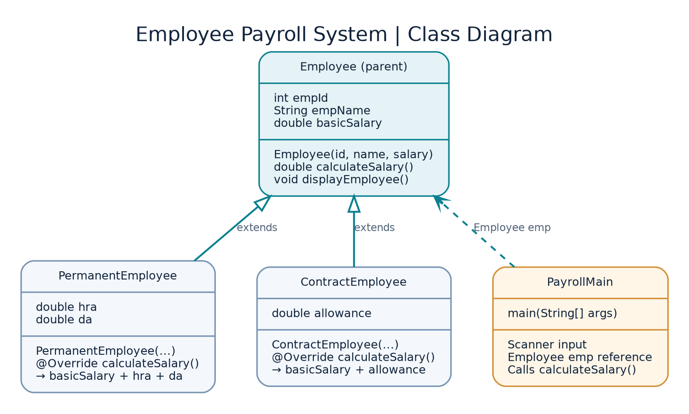
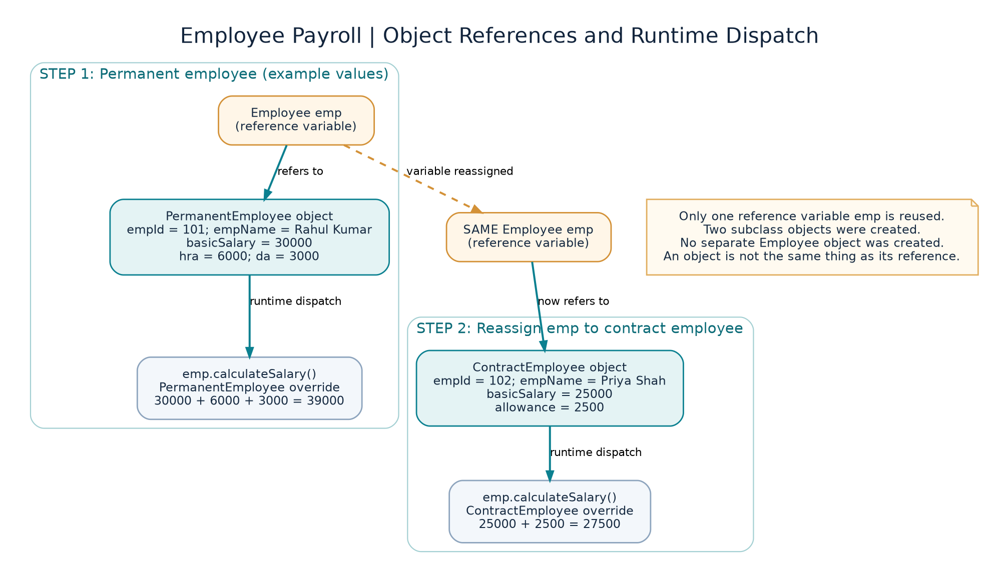

# Java Assignment 4 — Problem 4: Employee Payroll System

**Concept:** Method Overriding — Runtime Polymorphism  
**Language:** Java (tested with OpenJDK 21)

## Problem overview

Calculate salaries for two employee categories:

- **PermanentEmployee:** basic salary + HRA + DA.
- **ContractEmployee:** basic salary + agreed allowance.

The assignment does not state HRA/DA rates, so **this implementation asks the user for HRA and DA amounts**, not percentages. It assumes valid numeric inputs.

## Actual project layout

```text
Assignment_6/
└── EmployeePayroll/
    ├── Employee.java
    ├── PermanentEmployee.java
    ├── ContractEmployee.java
    ├── PayrollMain.java
    ├── README.md
    └── diagrams/
        ├── class-diagram.png
        ├── execution-flow.png
        └── object-memory.png
```

The Java package is `EmployeePayroll` (capital E and P). Place all four `.java` files in the `EmployeePayroll` folder.

## Class responsibilities

| Class | Purpose |
|---|---|
| `Employee` | Parent class: ID, name, basic salary; constructor; base `calculateSalary()` and `displayEmployee()` |
| `PermanentEmployee` | Inherits from Employee; stores HRA/DA amounts; overrides `calculateSalary()` |
| `ContractEmployee` | Inherits from Employee; stores allowance; overrides `calculateSalary()` |
| `PayrollMain` | Reads user input, creates both subclass objects and calls methods through an `Employee` reference |

## Class diagram



Both `PermanentEmployee` and `ContractEmployee` use `extends Employee` and replace the implementation of `calculateSalary()`.

## Execution flow


### Step-by-step description

1. `PayrollMain.main()` starts and constructs a `Scanner`.
2. The user enters details of one permanent employee, including HRA and DA amounts.
3. `new PermanentEmployee(...)` starts the subclass constructor. `super(...)` calls the `Employee` constructor to initialize ID, name and basic salary; the subclass stores HRA and DA.
4. `Employee emp` references this `PermanentEmployee` object.
5. `emp.displayEmployee()` prints the inherited details.
6. `emp.calculateSalary()` runs the **PermanentEmployee override** and returns `basicSalary + hra + da`.
7. The user enters details of one contract employee and its agreed allowance.
8. `new ContractEmployee(...)` creates an object; `super(...)` initializes inherited values and the subclass stores allowance.
9. The existing `emp` reference variable is reassigned to this `ContractEmployee` object.
10. `emp.calculateSalary()` now runs the **ContractEmployee override** and returns `basicSalary + allowance`.
11. The program closes the Scanner and finishes.

## Object and memory diagram



In the code, `Employee emp` is **one variable** whose reference changes from a `PermanentEmployee` object to a `ContractEmployee` object. The objects are distinct. There is no separate `new Employee()` object in the program.

## How to compile and run

Open the terminal **inside `Assignment_6`**, the parent of the `EmployeePayroll` package folder:

```bash
javac EmployeePayroll/*.java
java EmployeePayroll.PayrollMain
```

## Sample input and salary calculation

| Field | Permanent employee | Contract employee |
|---|---:|---:|
| ID | 101 | 102 |
| Name | Rahul Kumar | Priya Shah |
| Basic salary | 30,000 | 25,000 |
| HRA amount | 6,000 | — |
| DA amount | 3,000 | — |
| Agreed allowance | — | 2,500 |
| **Calculated salary** | **39,000** | **27,500** |

Relevant console output:

```text
--- Permanent Employee Details ---
Employee ID: 101
Employee Name: Rahul Kumar
Basic Salary: 30000.0
Calculated Salary: 39000.0

--- Contract Employee Details ---
Employee ID: 102
Employee Name: Priya Shah
Basic Salary: 25000.0
Calculated Salary: 27500.0
```

## Important Java concepts

- **Inheritance:** `class PermanentEmployee extends Employee` means PermanentEmployee is a type of Employee.
- **Parent constructor:** `super(empId, empName, basicSalary)` initializes the inherited fields.
- **Overriding:** A subclass provides its own method with the same name, parameter list, and compatible return type as the parent method. `@Override` helps the compiler catch mistakes.
- **Runtime polymorphism:** `Employee emp` can refer to either subclass object; `emp.calculateSalary()` invokes the override of the actual object at runtime.
- **Python comparison:** Java `super(...)` corresponds to calling the parent initializer (often `super().__init__(...)`) in Python.

## Five assessment/viva questions

1. **What is method overriding?** A subclass provides a new implementation of an inherited method with the same signature.
2. **Why do we use `super(...)`?** To invoke the parent constructor and initialize its fields.
3. **What does `extends` mean?** It defines inheritance between a subclass and its parent.
4. **Why can `Employee emp` hold a `PermanentEmployee` object?** Because PermanentEmployee is a subclass of Employee, so its object can be referenced by the parent type.
5. **Why is this runtime polymorphism?** Calling `emp.calculateSalary()` executes the override selected from the actual object type, not just the declared reference type.

## Faculty explanation in five sentences

I created a parent class `Employee` containing employee ID, name and basic salary. I created `PermanentEmployee` and `ContractEmployee` classes using `extends Employee`. Their constructors call `super(...)` to initialize the parent fields. Both subclasses override `calculateSalary()` to apply their own salary rules. In `PayrollMain`, I used an `Employee` reference to call the correct overridden method on both subclasses, demonstrating runtime polymorphism.
