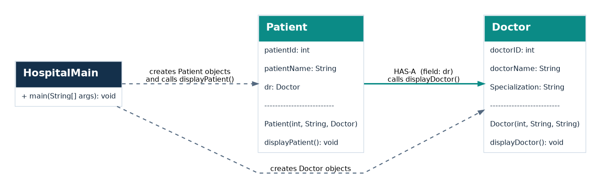
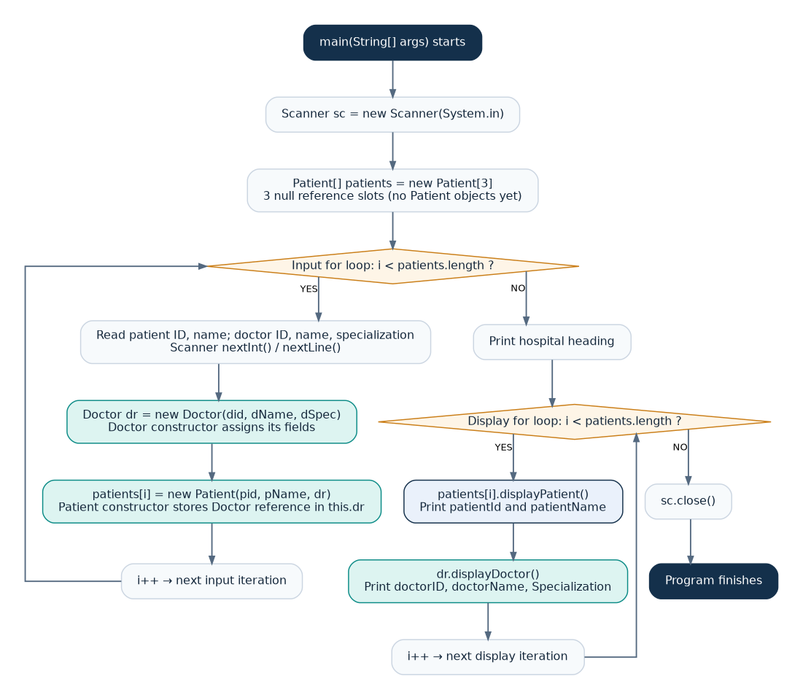
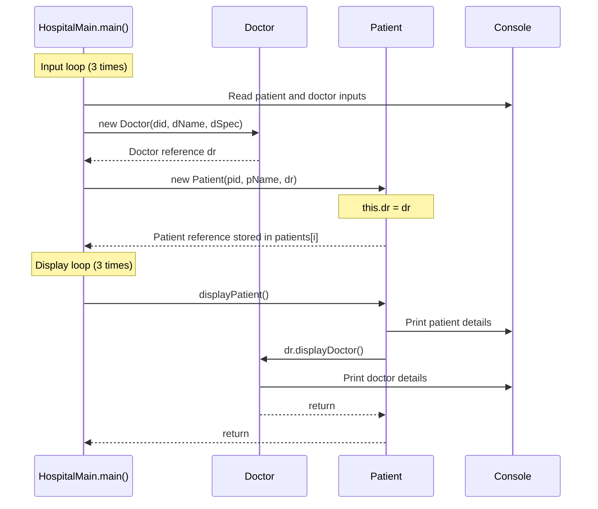

# Java Assignment 6 — Hospital Management System

**Concept:** Has-A relationship between `Patient` and `Doctor`  
**Package:** `HospitalManagement`  
**Language:** Java  
**Input:** `Scanner` (3 patients)

> This README documents the **actual code** in `HospitalManagement/Doctor.java`, `HospitalManagement/Patient.java`, and `HospitalManagement/HospitalMain.java`. It does not change the existing Java source files.

## 1. Project structure

```text
Assignment_6/
├── README.md
├── HospitalManagement/
│   ├── Doctor.java
│   ├── HospitalMain.java
│   └── Patient.java
└── diagrams/
    ├── class-diagram.png
    ├── class-diagram.svg
    ├── execution-flow.png
    └── execution-flow.svg
```

The Java source files existed already; `README.md` and `diagrams/` are the documentation additions.

## 2. What each class does

| File | Fields / role | Main behavior |
| --- | --- | --- |
| `Doctor.java` | `doctorID`, `doctorName`, `Specialization` | `Doctor(...)` initializes the fields; `displayDoctor()` prints them. |
| `Patient.java` | `patientId`, `patientName`, `Doctor dr` | `Patient(...)` stores the passed Doctor reference; `displayPatient()` prints patient details and calls `dr.displayDoctor()`. |
| `HospitalMain.java` | `main(String[] args)` | Reads input using `Scanner`, creates an array of 3 patients, creates objects in a loop, and displays all records in another loop. |

## 3. Class diagram — relationships



**Has-A:** `Patient` holds the `Doctor dr` reference. The doctor is instantiated in `HospitalMain` and then passed to the patient constructor; **a new doctor is not created inside `Patient`**.

This implementation demonstrates a Has-A association. Because the Doctor object is created independently and passed into Patient, the specific relationship is often described as *aggregation/association* rather than strict lifecycle-owned composition.

## 4. Program execution flow — which step runs next



### First loop — create objects

1. `Patient[] patients = new Patient[3];` allocates **3 reference slots**, initially `null`.
2. `for (int i = 0; i < patients.length; i++)` runs 3 times.
3. The program reads patient and doctor details from the keyboard using `Scanner`.
4. `Doctor dr = new Doctor(did, dName, dSpec);` creates a Doctor object and calls its constructor.
5. `patients[i] = new Patient(pid, pName, dr);` creates a Patient and passes the **existing** Doctor reference to its constructor.
6. `this.dr = dr;` inside `Patient` stores that reference (the Has-A connection).

### Second loop — display objects

1. `patients[i].displayPatient();` calls the Patient method for each array element.
2. `displayPatient()` prints patient ID and name.
3. `dr.displayDoctor()` calls the linked Doctor's method to print doctor ID, name, and specialization.
4. The loop proceeds to the next patient. After all 3, `sc.close()` executes.

## 5. Method-call sequence



## 6. Object reference diagram — first patient

```text
patients[0] ───► Patient object
                 patientId = 101
                 patientName = "Rahul Kumar"
                 dr ───────────────┐
                                    ▼
                             Doctor object
                             doctorID = 11
                             doctorName = "Dr Mehta"
                             Specialization = "Cardiology"
```

On every input-loop iteration, your code executes `new Doctor(...)` and `new Patient(...)`, so **3 Patient objects and 3 Doctor objects** are created. These patients do **not** share the same Doctor object in the current implementation.

## 7. How to compile and run

From the `Assignment_6` directory on your Mac:

```bash
javac HospitalManagement/*.java
java HospitalManagement.HospitalMain
```

Do **not** use `java HospitalMain` because the source files declare `package HospitalManagement;`.

### Example input

Enter the following values one by one when prompted:

```text
101
Rahul Kumar
11
Dr Mehta
Cardiology
102
Priya Shah
12
Dr Rao
Neurology
103
Amit Das
13
Dr Singh
Orthopedics
```

### Relevant output

```text
----------Hospital Patient Details---------------
Patient :1
Patient Id:101
Patient Name:Rahul Kumar
Doctor Id:11
Doctor Name:Dr Mehta
Specialization :Cardiology
Patient :2
Patient Id:102
Patient Name:Priya Shah
Doctor Id:12
Doctor Name:Dr Rao
Specialization :Neurology
Patient :3
Patient Id:103
Patient Name:Amit Das
Doctor Id:13
Doctor Name:Dr Singh
Specialization :Orthopedics
```

## 8. Java concepts for exam and viva

| Java statement | What happens |
| --- | --- |
| `Doctor dr;` | Declares a Doctor reference. |
| `new Doctor(...)` | Allocates a Doctor object and executes its constructor. |
| `new Patient(...)` | Allocates a Patient object and executes its constructor. |
| `this.dr = dr;` | Copies the existing Doctor reference into the Patient field. |
| `new Patient[3]` | Allocates an array of 3 references, **not** 3 Patient objects. |
| `patients[i].displayPatient()` | Calls the method on the Patient referenced at index `i`. |
| `dr.displayDoctor()` | Calls the method on the Doctor assigned to that Patient. |
| `sc.nextLine()` after `sc.nextInt()` | Consumes the remaining newline so names can be read correctly. |

**Simple viva answer:** "I created `Doctor` and `Patient` classes. `Patient` has a field of type `Doctor`, so it demonstrates a Has-A relationship. In `main()`, I use Scanner and a loop to create three Doctor and Patient objects. I store Patient references in an array. A second loop calls `displayPatient()`, which calls `displayDoctor()` to show the assigned doctor's details."

---

*Documentation is based on the current `Assignment_6/HospitalManagement` program. Update the diagrams if the Java source changes.*
