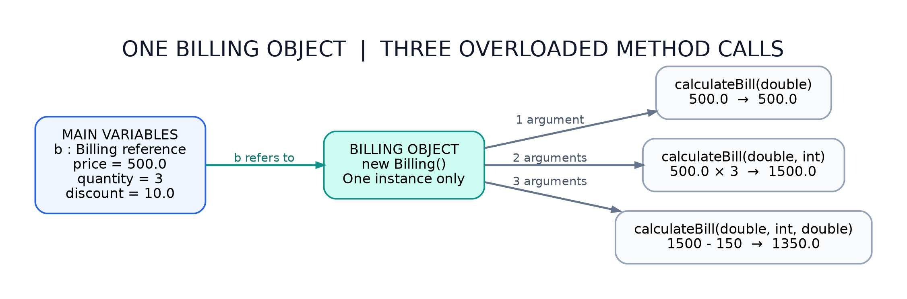

# Java Assignment 4 — Problem 2: Online Shopping Billing System

**Concept:** Method Overloading (Compile-Time Polymorphism)  
**Package:** `OnlineShoppingBilling`  
**Level:** Beginner — simple methods, `Scanner`, and separate Java files

## Objective

Create a `Billing` class with three methods named `calculateBill` that accept different parameter lists. Take a product price, quantity, and discount percentage from the user. Call **all three overloaded methods** and print the returned bills.

## Actual Project Structure

```text
Assignment_6/
└── OnlineShoppingBilling/
    ├── Billing.java
    ├── ShoppingMain.java
    ├── README.md
    └── diagrams/
        └── object-memory.png
```

> This is a new folder for Problem 2. The existing `Assignment_6/HospitalManagement` project is unchanged. The filename `Assignment_6` follows the folder used for your previous Java program.

## Files and Responsibilities

| File                | Responsibility                                                                                          |
| ------------------- | ------------------------------------------------------------------------------------------------------- |
| `Billing.java`      | Defines three overloaded `calculateBill()` methods with simple formulas.                                |
| `ShoppingMain.java` | Uses `Scanner` for keyboard input; creates a `Billing` object; calls all three methods; prints results. |

## Class Diagram


`ShoppingMain` **creates and uses** one `Billing` object. No inheritance is involved. The compiler chooses the correct overloaded method from the arguments supplied.

## Execution Flow


The method calls execute **in the order of their print statements**: first one argument, then two, then three. Each method computes and returns a `double` value.

## Object Reference and Method Dispatch



`Billing b = new Billing();` creates **one object**. Calling `b.calculateBill(...)` three times does not create three `Billing` objects.

## How Method Overloading Works

All three methods have the same name, but different parameter lists:

```java
double calculateBill(double price)
double calculateBill(double price, int quantity)
double calculateBill(double price, int quantity, double discount)
```

| Main's method call                           | Matching method       | Calculation                                                |
| -------------------------------------------- | --------------------- | ---------------------------------------------------------- |
| `b.calculateBill(price)`                     | One `double`          | `price`                                                    |
| `b.calculateBill(price, quantity)`           | `double, int`         | `price * quantity`                                         |
| `b.calculateBill(price, quantity, discount)` | `double, int, double` | `(price * quantity) - (price * quantity * discount / 100)` |

The **compiler** selects a matching method based on parameter count and types. Overloading is **compile-time polymorphism**. Changing only the return type does _not_ overload a Java method.

### Code Walkthrough

1. `Scanner sc = new Scanner(System.in);` — create a keyboard-input reader.
2. `Billing b = new Billing();` — create one Billing object.
3. `nextDouble()` and `nextInt()` — read price, quantity, and discount percentage.
4. `b.calculateBill(price)` — return the single-product price.
5. `b.calculateBill(price, quantity)` — return `price * quantity`.
6. `b.calculateBill(price, quantity, discount)` — first calculate the total, then the discount amount, then subtract it.
7. `System.out.println(...)` — print each returned result.
8. `sc.close();` — close the Scanner.

### Dry Run

Inputs: `price = 500`, `quantity = 3`, `discount = 10` (percent).

```text
Single bill      = 500
Multiple bill    = 500 * 3 = 1500
Discount amount  = 1500 * 10 / 100 = 150
Discounted bill  = 1500 - 150 = 1350
```

### Example Run

```text
Enter product price: 500
Enter quantity: 3
Enter discount percentage: 10
Single Product Bill: 500.0
Multiple Products Bill: 1500.0
Bill After Discount: 1350.0
```

**Assumption:** Discount is a percentage; enter `10` for 10%. For this beginner assessment example, provide nonnegative prices, positive quantities, and percentage between 0 and 100. The sample intentionally omits additional input validation so the method overloading is easy to see.

## Compile and Run (Mac / VS Code)

Open the terminal **inside `Assignment_6`**, which is the parent of the `OnlineShoppingBilling` package directory:

```bash
cd /Users/aagmantiwari/Java-Module/java-practice/Assignment_6
javac OnlineShoppingBilling/*.java
java OnlineShoppingBilling.ShoppingMain
```

Do not run `java ShoppingMain` from inside the package directory: the source has `package OnlineShoppingBilling;` and must be launched using its package-qualified class name from the parent directory.

## Python Comparison

In Python, one might use optional arguments to calculate bills with different inputs. In this Java assignment, **three methods with the same name but distinct parameter lists** demonstrate the specific concept of Java method overloading.

## Viva / Assessment Questions

**Q1. What is method overloading?**  
Methods with the same name but different parameter lists in the same class.

**Q2. Why is this compile-time polymorphism?**  
The Java compiler resolves the method call using the number and types of arguments.

**Q3. Can we overload by changing only the return type?**  
No. Return type alone is not enough; the parameter list must differ.

**Q4. How many `Billing` objects are created?**  
One: `new Billing()` is executed once in `main()`.

**Q5. What is the third method's discount formula?**  
`total = price * quantity`; `discountAmount = total * discount / 100`; return `total - discountAmount`.

## Faculty Explanation (Short)

"I created a Billing class with three `calculateBill` methods having different parameters. The first calculates one product's price; the second multiplies price by quantity; and the third applies a percentage discount to the total. I used Scanner to accept the input and called all three methods from a separate main class. This demonstrates compile-time polymorphism because Java selects the matching overloaded method based on its arguments."
