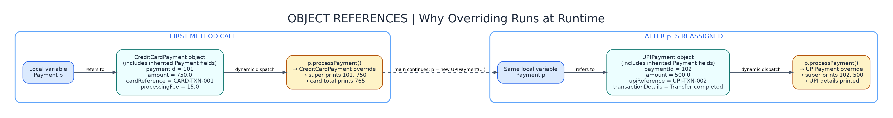

# Java Assignment 4 — Problem 5: Payment Processing System

**Concept:** Method Overriding (Runtime Polymorphism)  
**Course:** C-DAC Java practice

## Objective
Create a parent `Payment` class and two child classes: `CreditCardPayment` and `UPIPayment`. Both children override `processPayment()`. In `PaymentMain`, the same **parent-class reference (`Payment p`)** calls the appropriate child method depending on the actual object.

## Actual Project Structure

```text
Assignment_6/
└── PaymentProcessing/
    ├── Payment.java
    ├── CreditCardPayment.java
    ├── UPIPayment.java
    ├── PaymentMain.java
    ├── README.md
    └── diagrams/
        ├── class-diagram.png
        ├── execution-flow.png
        └── object-memory.png
```

All four `.java` files declare `package PaymentProcessing;`. Diagrams are **PNG only**.

## Classes and Responsibilities

| File | Responsibility |
| --- | --- |
| `Payment.java` | Stores `paymentId`, `amount`, initializes them using a constructor, and prints general payment details in `processPayment()`. |
| `CreditCardPayment.java` | Inherits Payment. Stores card reference and processing fee. Its override calls `super.processPayment()`, then displays card details and `amount + processingFee`. |
| `UPIPayment.java` | Inherits Payment. Stores UPI reference and transaction details. Its override calls `super.processPayment()`, then displays UPI details. |
| `PaymentMain.java` | Reads user input using `Scanner`, creates one object of each child type using a `Payment` reference, and invokes `processPayment()` on both. |

The processing fee is **an amount entered by the user**, not a fixed fee or assumed percentage. This is a beginner-friendly classroom example using valid inputs.

## Class Diagram


The arrows labeled `extends` indicate **Is-A** (inheritance). Both child classes provide their own `processPayment()` implementation.

## Execution Flow Diagram


### Exact Order of Execution

1. `PaymentMain.main()` creates a Scanner and reads credit-card payment details.
2. `new CreditCardPayment(...)` runs. Its constructor calls `super(...)` to initialize the parent fields, then initializes card reference and processing fee.
3. A **parent reference** is assigned: `Payment p = new CreditCardPayment(...);`.
4. `p.processPayment()` executes the **CreditCardPayment** override because that is the actual object type.
5. Inside the override, `super.processPayment()` prints general details, and the remaining statements display reference, fee, and total amount.
6. Main reads UPI payment details and executes `p = new UPIPayment(...)` (the same variable now refers to a different object).
7. `p.processPayment()` executes the **UPIPayment** override; the method first prints parent details, then UPI details.
8. `sc.close()` finishes input processing.

## Object / Memory Diagram



- `Payment p` is a **reference variable**. The object created by `new CreditCardPayment(...)` is a child-class object.
- When `p = new UPIPayment(...)` runs, the variable is reassigned to the newly created UPI object; it does not change the first object's type.
- For overridden instance methods, Java uses the **actual referenced object's class** at runtime to select the method.
- `super.processPayment()` explicitly runs the parent method from inside a child override.

## How to Compile and Run (Mac / VS Code)

Open the terminal from the **`Assignment_6` directory**, then run:

```bash
javac PaymentProcessing/*.java
java PaymentProcessing.PaymentMain
```

> If your shell is already in `Assignment_6/PaymentProcessing`, move up one directory (`cd ..`) before running these commands.

## Example Test Input

Enter the following values in the order requested:

```text
101
750
CARD-TXN-001
15
102
500
UPI-TXN-002
Transfer completed
```

## Expected Payment Details

```text
--- Credit Card Payment Details ---
Payment ID: 101
Payment Amount: 750.0
Card Transaction Reference: CARD-TXN-001
Processing Fee: 15.0
Total Amount: 765.0

--- UPI Payment Details ---
Payment ID: 102
Payment Amount: 500.0
UPI Transaction Reference: UPI-TXN-002
Transaction Details: Transfer completed
```

(The application also displays prompts before accepting each input.)

## Python Comparison

In Python, a subclass can redefine a method such as `process_payment(self)`. Java overriding is similar, but Java uses `extends`, the same method signature, and optionally `@Override`. When `Payment p` refers to a `CreditCardPayment` object, Java invokes that child's method at **runtime**.

## Viva / Assessment Questions

**Q1. What is method overriding?**  
A child class gives a new implementation of an inherited method with a compatible method signature.

**Q2. What does `extends` mean?**  
It creates an inheritance (Is-A) relationship; a CreditCardPayment **is a** Payment.

**Q3. Why use `super(paymentId, amount)`?**  
To call the parent constructor and initialize parent fields.

**Q4. Why is it runtime polymorphism?**  
Java chooses which overridden `processPayment()` to execute based on the actual object referenced by `Payment p` at runtime.

**Q5. What does `super.processPayment()` do?**  
It runs the parent-class method to display common payment ID and amount before showing payment-specific details.

**Q6. Why is `sc.nextLine()` used after `nextInt()` or `nextDouble()`?**  
To consume the leftover newline before reading a full text line, such as a transaction reference.

## Key Exam Statement

> `Payment p = new CreditCardPayment(...); p.processPayment();` calls CreditCardPayment's overridden method. Reassigning `p = new UPIPayment(...)` makes the same method call invoke UPIPayment's implementation. This is **runtime polymorphism**.
